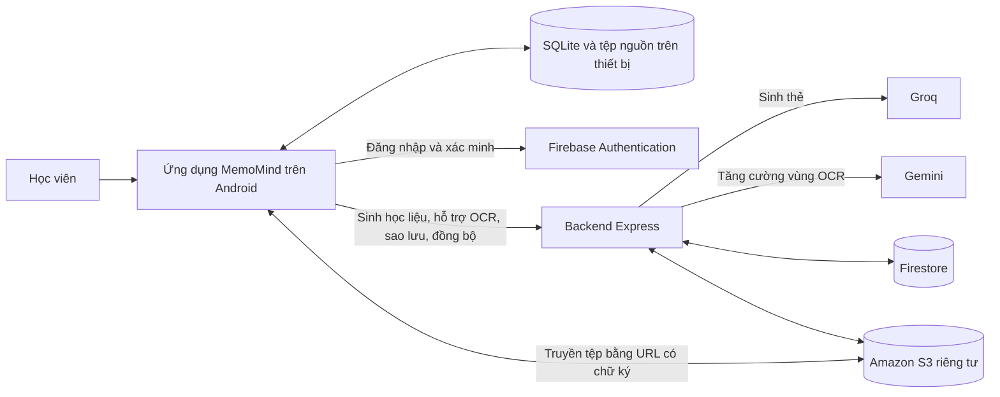

# CHƯƠNG 1. PHÂN TÍCH YÊU CẦU HỆ THỐNG

## 1.1. Bài toán, tác nhân và bối cảnh sử dụng

MemoMind phục vụ người học có tài liệu ở dạng ảnh chụp hoặc PDF và muốn chuyển nội dung đó thành bộ thẻ ôn tập. Một lần sử dụng điển hình bắt đầu bằng việc nhập tài liệu, xem và chuẩn hóa từng trang, chạy nhận dạng ký tự quang học (OCR), rồi kiểm tra các đoạn văn bản trước khi yêu cầu sinh học liệu. Học viên tiếp tục xem, sửa hoặc loại các thẻ được đề xuất, lưu thẻ phù hợp vào một bộ học và ôn theo lịch. Trong quá trình học, ứng dụng cần giữ được nội dung thẻ, nguồn tham chiếu, lịch sử đánh giá và ngày ôn kế tiếp. Tác nhân chính vì vậy là học viên; việc tạo câu hỏi và xác nhận nội dung vẫn thuộc quyền quyết định của người này.

Luồng học tập cốt lõi được tổ chức quanh dữ liệu trên thiết bị. Ảnh, trang tài liệu, văn bản OCR đã xác nhận, bộ thẻ và lịch sử ôn được lưu trong tệp cục bộ và SQLite. Học viên có thể tạo thẻ thủ công, mở học liệu đã lưu, ôn tập, nhận thông báo cục bộ và xem thống kê mà không cần đăng nhập. Kết nối mạng được yêu cầu khi ứng dụng gửi nội dung đã chọn tới dịch vụ AI hoặc khi người dùng sử dụng tài khoản để sao lưu và đồng bộ. Việc tách điều kiện kết nối theo tác vụ giúp hệ thống giữ được chức năng học tập khi mạng gián đoạn, đồng thời cho phép báo rõ thao tác nào phải chờ dịch vụ bên ngoài.

Ở ranh giới hệ thống, ứng dụng Android giao tiếp với backend Express để sinh thẻ qua Groq và, khi người dùng yêu cầu, tăng cường OCR cho một vùng ảnh qua Gemini. Firebase Authentication quản lý danh tính tài khoản. Backend sử dụng Firestore cho dữ liệu phục vụ đồng bộ và metadata sao lưu; các tệp nguồn và gói sao lưu được lưu trong Amazon S3 riêng tư. Việc truyền tệp tới S3 sử dụng URL được backend cấp sau khi xác thực và kiểm tra yêu cầu. Sơ đồ 1.1 thể hiện các thành phần và hướng trao đổi chính; mũi tên tới dịch vụ cloud biểu thị tác vụ cần mạng, còn lưu trữ cục bộ nằm trong phạm vi thiết bị.

**Sơ đồ 1.1. Bối cảnh sử dụng và ranh giới của MemoMind**

**Bảng 1.1. Tác nhân, thành phần liên quan và điều kiện kết nối**

| Tác nhân hoặc thành phần | Vai trò trong hệ thống | Điều kiện kết nối |
| --- | --- | --- |
| Học viên | Nhập tài liệu, xác nhận OCR, duyệt thẻ, ôn tập và theo dõi tiến độ; quyết định đăng nhập và đồng bộ. | Các thao tác học cục bộ không cần mạng; tác vụ AI và cloud cần mạng. |
| Ứng dụng Android | Điều phối giao diện, xử lý ảnh/OCR, ghi dữ liệu học và gọi các dịch vụ khi cần. | Hoạt động ngoại tuyến cho các chức năng cục bộ. |
| SQLite và tệp nguồn trên thiết bị | Lưu học liệu, nguồn, lịch ôn, sự kiện học và các thay đổi chờ đồng bộ. | Không cần mạng. |
| Backend Express | Kiểm tra yêu cầu, giữ khóa dịch vụ AI, cung cấp API sinh học liệu, sao lưu và đồng bộ. | Cần mạng từ ứng dụng đến backend. |
| Groq | Tạo bản nháp thẻ BASIC, CLOZE và MCQ từ nội dung nguồn đã gửi. | Backend cần kết nối tới nhà cung cấp. |
| Gemini | Hỗ trợ đọc lại vùng ảnh OCR được người dùng chọn. | Chỉ gọi qua backend khi người dùng yêu cầu và có mạng. |
| Firebase Authentication | Đăng nhập và xác minh danh tính cho các luồng tài khoản. | Cần mạng cho các thao tác xác thực với dịch vụ. |
| Firestore | Lưu thư viện chuẩn, phiên bản thay đổi, xung đột và metadata phục vụ cloud. | Backend cần kết nối tới dịch vụ. |
| Amazon S3 | Lưu tệp nguồn và gói sao lưu riêng tư; hỗ trợ truyền tệp bằng URL có chữ ký. | Cần mạng khi tải lên hoặc tải về. |

## 1.2. Yêu cầu chức năng theo nhóm

Yêu cầu chức năng được xác định theo kết quả mà học viên cần đạt ở mỗi bước, từ chuẩn bị tài liệu đến sử dụng học liệu đã lưu. Các mã FR01–FR17 thuộc luồng học tập chính; FR18–FR20 mở rộng việc quản lý dữ liệu theo tài khoản. Mức ưu tiên P0 thể hiện chức năng cốt lõi để hoàn thành quy trình học trên Android, còn P1 thể hiện chức năng phụ thuộc hạ tầng tài khoản và cloud. Trạng thái trong Bảng 1.2 nói về mức hiện thực và bằng chứng hiện có, không thay thế kết quả nghiệm thu cuối cùng trên mọi thiết bị hoặc môi trường triển khai.

### 1.2.1. Tiếp nhận và chuẩn hóa tài liệu

Hệ thống phải cho phép học viên chụp ảnh bằng camera, chọn ảnh từ thư viện hoặc nhập PDF. Ảnh và tệp gốc được giữ gắn với tài liệu để có thể đối chiếu sau này. Với PDF, người dùng chọn tối đa mười trang cho một lượt xử lý; ứng dụng tạo ảnh trang để đưa vào cùng quy trình xử lý như ảnh chụp. Trước khi OCR, người dùng có thể xem trang, chọn vùng cắt, xoay và điều chỉnh ảnh. Khi tệp không hợp lệ, PDF được bảo vệ bằng mật khẩu, ảnh không đọc được hoặc thao tác xử lý thất bại, giao diện phải thông báo nguyên nhân phù hợp và cho phép thử lại hoặc chọn nguồn khác mà không tạo một tài liệu hoàn chỉnh sai lệch.

### 1.2.2. Nhận dạng và xác nhận văn bản nguồn

OCR được thực hiện trên thiết bị bằng ML Kit. Kết quả không chỉ là một chuỗi văn bản chung mà còn gồm các khối gắn với tài liệu, số trang và vị trí trên ảnh để phục vụ hiệu chỉnh và xem nguồn. Giao diện đặt ảnh và văn bản cạnh nhau, cho phép học viên sửa đoạn nhận dạng và xác nhận phần sẽ dùng làm đầu vào cho AI. Nếu cần hỗ trợ thêm ở một vùng khó đọc, người dùng chủ động chọn vùng ảnh và yêu cầu gửi riêng vùng đó qua backend tới Gemini. Ứng dụng phải giữ sự phân biệt giữa văn bản nhận dạng ban đầu, văn bản đã được người dùng sửa và vị trí chỉ còn hợp lệ khi khớp với ảnh hiện tại; độ tin cậy dạng số không được giả định có sẵn vì adapter ML Kit hiện không cung cấp trường này.

### 1.2.3. Sinh và duyệt học liệu

Từ những khối nguồn đã được xác nhận, học viên chọn một hoặc nhiều loại thẻ BASIC, CLOZE và MCQ, đồng thời chọn số lượng tự động hoặc số lượng mong muốn trong giới hạn được giao diện hỗ trợ. Ứng dụng gửi yêu cầu tới backend; khóa API của nhà cung cấp chỉ nằm ở phía server. Kết quả sinh ra được đưa vào màn hình duyệt, kể cả khi thẻ có cảnh báo về nội dung, nguồn hoặc câu hỏi trùng. Học viên có thể xem, sửa, chọn lưu, bỏ qua hoặc tạo lại thẻ. Trước khi ghi vào SQLite, hệ thống kiểm tra cấu trúc thẻ đủ dùng và quyền sở hữu nguồn; cảnh báo về trích dẫn hoặc liên kết chưa xác định được vẫn được thể hiện để người dùng quyết định. Một thẻ không xác lập được liên kết chắc chắn không được gán tùy tiện vào khối nguồn khác. Việc lưu những thẻ đã chọn phải diễn ra trọn vẹn trong một giao dịch để tránh bộ thẻ chỉ nhận một phần khi xảy ra lỗi.

### 1.2.4. Quản lý bộ thẻ, xem nguồn và ôn tập

Học viên cần tạo, đổi tên, gắn nhãn, tìm kiếm và xóa bộ thẻ; trong mỗi bộ, họ có thể thêm, chỉnh sửa, tìm kiếm và xóa thẻ BASIC, CLOZE hoặc MCQ. Thẻ tạo thủ công không bắt buộc có tài liệu nguồn. Với thẻ có nguồn, thao tác xem nguồn phải mở đúng trang và hiển thị câu trích; vùng ảnh chỉ được tô sáng khi khối và tọa độ đã được xác minh trên ảnh tương ứng. Khi nguồn bị thiếu hoặc hỏng, nội dung học và phần trích dẫn còn lưu phải tiếp tục truy cập được trong giới hạn dữ liệu hiện có.

Phiên ôn có thể lấy các thẻ đến hạn hoặc được bắt đầu ở chế độ ôn tự do. Sau khi lật để xem đáp án, học viên chọn một trong bốn mức Again, Hard, Good, Easy. Mỗi đánh giá tạo một sự kiện học, cập nhật lịch dựa trên SM-2 và thay đổi hàng đợi phiên trong cùng giao dịch. Again đưa thẻ trở lại cuối phiên để học lại; phiên chưa hoàn tất được lưu để tiếp tục sau khi rời màn hình hoặc mở lại ứng dụng. Các thẻ đã xóa hoặc tạm ngừng không được đưa trở lại hàng đợi ôn, trong khi lịch sử các lượt học đã ghi vẫn được bảo toàn. MCQ tham gia cùng luồng thẻ học; yêu cầu này không bao hàm một chế độ thi trắc nghiệm có bấm giờ riêng.

### 1.2.5. Nhắc học và thống kê cục bộ

Người dùng có thể bật nhắc học và chọn một giờ địa phương trong ngày. Ứng dụng chỉ lập lịch thông báo cho những ngày dự kiến có thẻ đến hạn trong cửa sổ lập lịch hiện hành; khi chạm thông báo, danh sách đến hạn được truy vấn lại theo dữ liệu tại thời điểm mở, vì trạng thái thẻ có thể đã đổi từ lúc thông báo được tạo. Quyền thông báo, kênh Android và lỗi lập lịch phải được hiển thị rõ để lựa chọn đã lưu của người dùng không bị nhầm với việc hệ điều hành chắc chắn sẽ phát thông báo đúng phút.

Trang chủ và màn hình Thống kê sử dụng cùng dữ liệu cục bộ để trình bày bốn chỉ số: số thẻ hiện đến hạn, số lượt đánh giá đã ghi trong ngày, tỷ lệ tự đánh giá đạt và chuỗi ngày học. Một thẻ được đánh giá nhiều lần tạo nhiều lượt; Hard, Good và Easy được tính là đạt, còn Again không đạt. Vì đây là phản hồi tự đánh giá sau khi xem đáp án, tỷ lệ đó không được gọi là tỷ lệ trả lời đúng của một bài kiểm tra độc lập. Việc xem thống kê không được thay đổi sự kiện ôn hoặc lịch của thẻ.

### 1.2.6. Tài khoản, sao lưu và đồng bộ

Người học có thể tiếp tục sử dụng kho khách hoặc đăng nhập bằng email hay Google để dùng những chức năng gắn với tài khoản. Tài khoản email cần hoàn tất bước xác minh trước khi sử dụng thư viện cloud. Dữ liệu được sao lưu thành bản có thể xem trước và khôi phục theo lựa chọn của người dùng. Đồng bộ trao đổi thay đổi của thư viện chuẩn theo từng tài khoản, giữ hàng đợi cục bộ khi mất mạng, tiếp nhận lại thao tác theo định danh để hạn chế ghi trùng và hiển thị xung đột nội dung cho người dùng giải quyết. Mặc định, người dùng chủ động bấm đồng bộ; họ có thể bật tự động đồng bộ trên thiết bị đang dùng. Các chức năng này không làm điều kiện tiên quyết cho thao tác học với dữ liệu đã lưu trên máy.

**Bảng 1.2. Ma trận yêu cầu chức năng và bằng chứng kiểm thử**

| Mã | Yêu cầu chính | Ưu tiên | Trạng thái thực hiện và giới hạn kiểm chứng | Mục kiểm thử tương ứng |
| --- | --- | --- | --- | --- |
| FR01–FR03 | Nhập ảnh/PDF, chọn trang và chuẩn hóa ảnh. | P0 | Đã hiện thực; có unit/widget test. Luồng camera–OCR toàn phần trên Android thật còn cần kiểm tra theo từng thiết bị. | `test/unit/local_document_import_repository_test.dart`, `test/widget/document_import_flow_test.dart`, `test/widget/pdf_import_flow_test.dart`, `test/widget/image_normalization_flow_test.dart` |
| FR04–FR06 | OCR trên thiết bị, hiệu chỉnh và lưu khối nguồn. | P0 | Đã hiện thực; có kiểm thử OCR, tọa độ và nguồn bằng fixture. Chưa có số đo CER/WER trên tập ảnh công bố. | `test/unit/ocr_orchestrator_test.dart`, `test/unit/local_ocr_repository_test.dart`, `test/unit/source_geometry_regression_test.dart`, `test/widget/ocr_dual_view_editor_test.dart` |
| FR07–FR10 | Sinh BASIC/CLOZE/MCQ, kiểm tra và duyệt trước khi lưu. | P0 | Đã hiện thực; backend và giao diện được kiểm thử bằng phản hồi giả lập, có thử prompt với nguồn nhân tạo. Chất lượng trên tập tài liệu người dùng chưa được định lượng. | `functions/test/materials.test.js`, `test/unit/material_generation_use_cases_test.dart`, `test/unit/material_review_api_test.dart`, `test/widget/flashcard_review_approval_test.dart` |
| FR11, FR15 / UC10 | Quản lý deck/card, tìm kiếm, xóa mềm và xem nguồn. | P0 | Đã hiện thực; unit/widget và một luồng quản lý/ôn ngoại tuyến trên Android đã được ghi nhận. | `test/unit/deck_management_test.dart`, `test/widget/deck_management_flow_test.dart`, `integration_test/offline_deck_review_test.dart` |
| FR12–FR14 / UC04–UC05 | Phiên ôn, bốn mức đánh giá, SM-2 và lưu tiến độ ngoại tuyến. | P0 | Đã hiện thực; unit/widget và integration test Android ngoại tuyến đã được ghi nhận. | `test/unit/sm2_scheduler_test.dart`, `test/unit/review_repository_test.dart`, `test/widget/review_session_screen_test.dart`, `integration_test/offline_deck_review_test.dart` |
| FR16 | Nhắc học theo giờ do người dùng chọn. | P0 | Đã hiện thực và có unit/widget/native contract test; các tình huống quyền, reboot và nhận thông báo thực còn cần nghiệm thu thiết bị. | `test/unit/reminder_coordinator_test.dart`, `test/widget/reminder_settings_screen_test.dart`, `integration_test/reminder_native_test.dart` |
| FR17 | Bốn chỉ số thống kê học tập cục bộ. | P0 | Đã hiện thực và có unit/widget test; integration test Android được cung cấp nhưng biên bản hiện có chưa xác nhận lần chạy trên thiết bị. | `test/unit/statistics_repository_test.dart`, `test/widget/statistics_screen_test.dart`, `integration_test/offline_statistics_test.dart` |
| FR18 | Đăng nhập, xác minh, sao lưu và khôi phục. | P1 | Đã hiện thực; Firebase/S3 thật đã được kết nối. Kiểm thử cục bộ và Firestore Emulator được ghi nhận; chưa có biên bản nghiệm thu sao lưu/khôi phục trên Android với dịch vụ thật. | `test/unit/account_backup_controller_test.dart`, `test/unit/workspace_backup_test.dart`, `functions/test/backups.test.js`, `functions/test/authentication.test.js` |
| FR19–FR20 | Đồng bộ tiến độ/nội dung và xử lý xung đột. | P1 | Đã hiện thực; Firebase/S3 thật đã được kết nối, có test hai workspace với backend giả/in-memory. Hội tụ trên hai Android vẫn cần biên bản nghiệm thu. | `test/unit/sync_integration_test.dart`, `test/unit/sync_scheduling_test.dart`, `functions/test/sync.test.js`, `functions/test/sync-firestore.test.js` |

Các đường dẫn trong Bảng 1.2 chỉ xác định nơi có ca kiểm thử hoặc kịch bản; sự tồn tại của một file integration test không có nghĩa ca đó đã chạy thành công trên thiết bị. Kết quả chi tiết, ngày chạy và môi trường của từng nhóm được phân tích ở Chương 4. Đối với FR16 và FR17, tài liệu kiểm chứng hiện có mô tả rõ các bước Android cần thực hiện; đối với FR18–FR20, kết quả dùng mock hoặc emulator chưa đủ để xác nhận cấu hình Firebase, chính sách S3 và hội tụ trên hai điện thoại thật.

## 1.3. Yêu cầu phi chức năng và tiêu chí kiểm chứng

Yêu cầu phi chức năng xác định mức tin cậy cần có của từng luồng nghiệp vụ. Với MemoMind, yêu cầu quan trọng nhất là khả năng học khi thiết bị mất kết nối. Sau khi thẻ và nguồn đã được lưu, thao tác mở bộ thẻ, thực hiện đánh giá, tạo ReviewEvent, tính lịch và tiếp tục phiên dở phải dựa vào dữ liệu cục bộ. Tiêu chí kiểm chứng là hoàn thành một phiên ôn khi tắt mạng, đóng và mở lại kho dữ liệu mà vẫn đọc được sự kiện, lịch và hàng đợi đã cam kết. Tác vụ cần AI hoặc cloud phải báo phụ thuộc kết nối và giữ được trạng thái cần thiết để người dùng thử lại.

Tính nhất quán dữ liệu đặc biệt quan trọng vì một lượt đánh giá làm thay đổi nhiều đối tượng cùng lúc. Sự kiện học, trạng thái lịch và hàng đợi phải được ghi trong cùng giao dịch; nếu ghi thất bại, giao diện không được chuyển sang thẻ tiếp theo như thể thao tác đã thành công. Khi thử lại, cùng định danh sự kiện phải tránh tạo thêm một lượt ôn. Đối với đồng bộ, outbox lưu các thay đổi chưa được xác nhận; server tiếp nhận thao tác theo định danh, còn xung đột nội dung phải giữ đủ dữ liệu để người dùng chọn cách giải quyết. Kiểm thử cần bao phủ mất phản hồi, gửi lại, ngắt mạng và thay đổi tài khoản trong lúc đồng bộ. Mức bằng chứng của các ca mô phỏng phải được trình bày tách khỏi kiểm tra thực tế với Firestore và S3.

Về bảo mật, khóa của Groq và Gemini thuộc backend, không nằm trong mã Flutter hoặc APK. Các API sao lưu/đồng bộ cần kiểm tra danh tính và quyền sở hữu dữ liệu; tài liệu của từng tài khoản và object trong S3 phải ở chế độ riêng tư. Ứng dụng chỉ gửi vùng ảnh OCR tùy chọn sau thao tác chủ động của người dùng. Backend cần giới hạn kích thước yêu cầu, kiểm tra cấu trúc dữ liệu và xử lý lỗi mà không đưa token, nội dung học hay URL có chữ ký vào nhật ký vận hành. Những yêu cầu này có thể được kiểm tra bằng unit/backend test, kiểm tra cấu hình và thử truy cập chéo tài khoản; test với adapter giả không chứng minh chính sách IAM hoặc bucket thật đã được triển khai đúng.

Khả dụng được đánh giá từ khả năng người dùng hiểu và sửa sai trong những bước có rủi ro cao. Màn hình OCR phải cho phép đối chiếu ảnh với văn bản; màn hình duyệt thẻ AI phải hiển thị nội dung và cảnh báo trước khi lưu. Các biểu mẫu cần giữ dữ liệu khi lưu thất bại, hỗ trợ thử lại và tránh thao tác kép khi đang xử lý. Với các trạng thái ngoại tuyến, thiếu quyền thông báo, không có thẻ đến hạn hoặc nguồn bị thiếu, ứng dụng cần thông báo cụ thể thay vì hiển thị dữ liệu giả. Kiểm thử giao diện nên bao gồm màn hình hẹp, cỡ chữ lớn, bàn phím mở và chế độ sáng/tối; các ca đã có trong widget test là bằng chứng cho tình huống được kiểm thử, chưa thay thế đánh giá khả năng tiếp cận trên toàn bộ thiết bị và trình đọc màn hình.

Hiệu năng và chất lượng đầu ra phải được trình bày bằng phép đo có thể lặp lại. Đối với OCR, báo cáo cần công bố tập ảnh, ngôn ngữ, thiết bị và văn bản chuẩn trước khi tính CER/WER và thời gian xử lý. Đối với AI, tỷ lệ phản hồi đúng cấu trúc phải được tách khỏi tỷ lệ thẻ đúng về nội dung, có nguồn hỗ trợ và được người học chấp nhận. Đối với giao diện và đồng bộ, cần mô tả kích thước dữ liệu, cấu hình thiết bị/mạng, cách lấy p50/p95 và số lần lặp. Hiện chưa có bộ số liệu định lượng đủ điều kiện để công bố các chỉ số này; các ô tương ứng được giữ ở trạng thái **[Cần bổ sung số liệu]**.

**Bảng 1.3. Tiêu chí kiểm chứng yêu cầu phi chức năng**

| Nhóm yêu cầu | Tiêu chí quan sát hoặc phép đo | Bằng chứng cần dùng | Trạng thái số liệu |
| --- | --- | --- | --- |
| Ngoại tuyến và lưu bền | Hoàn tất ôn khi tắt mạng; mở lại vẫn có ReviewEvent, lịch và phiên dở. | Unit/repository test và `integration_test/offline_deck_review_test.dart` trên Android. | Có bằng chứng chức năng; cần ghi rõ môi trường từng lần chạy. |
| Tính nhất quán | Transaction rollback khi lỗi; gửi lại không tạo sự kiện/đối tượng trùng; xung đột giữ dữ liệu để xử lý. | `test/unit/review_repository_test.dart`, `test/unit/sync_integration_test.dart`, `functions/test/sync.test.js`; kịch bản hai thiết bị thật. | Test tự động đã có; cần biên bản hội tụ trên hai Android qua dịch vụ đã kết nối. |
| Bảo mật và riêng tư | APK không chứa khóa AI server; API từ chối truy cập khác chủ; bucket không công khai; log không chứa bí mật hoặc nội dung học. | Rà cấu hình build, backend/auth tests, Firestore Emulator, kiểm tra IAM và S3 thật. | Một phần đã kiểm thử; Firebase/S3 đã kết nối, còn cần bằng chứng kiểm tra quyền IAM và bucket thực tế. |
| Khả dụng và tiếp cận | Sửa OCR/thẻ AI được; lỗi có thể thử lại; bố cục đọc được trên màn hình nhỏ, chữ lớn và hai theme. | Widget test, ảnh giao diện, kiểm tra thủ công Android và trình đọc màn hình. | Có widget test; đánh giá khả năng tiếp cận toàn diện còn thiếu. |
| Chất lượng OCR | CER, WER và độ trễ theo bộ ảnh, ngôn ngữ, thiết bị và điều kiện chụp công bố. | Bộ ảnh có văn bản chuẩn và phép đo lặp lại. | **[Cần bổ sung số liệu]** |
| Chất lượng học liệu AI | Tỷ lệ thẻ đúng nội dung, được nguồn hỗ trợ, trùng, cần sửa và được chấp nhận. | Mẫu nguồn, tiêu chí chấm và đánh giá độc lập của người đọc. | **[Cần bổ sung số liệu]** |
| Hiệu năng ứng dụng và đồng bộ | Phân bố p50/p95 cho thao tác chính theo thiết bị, kích thước dữ liệu và điều kiện mạng. | Log đo có thời điểm, cấu hình và số lần chạy. | **[Cần bổ sung số liệu]** |

Các tiêu chí trong Bảng 1.3 là kế hoạch đánh giá cho sản phẩm hiện tại. Chúng không quy định sẵn một ngưỡng đạt khi chưa có thiết bị tham chiếu, tập dữ liệu và quy trình đo thống nhất. Chương kiểm thử sẽ ghi kết quả thực tế cùng giới hạn của từng phép thử; những đại lượng chưa đo sẽ không được suy ra từ việc mã nguồn đã hiện thực chức năng.
