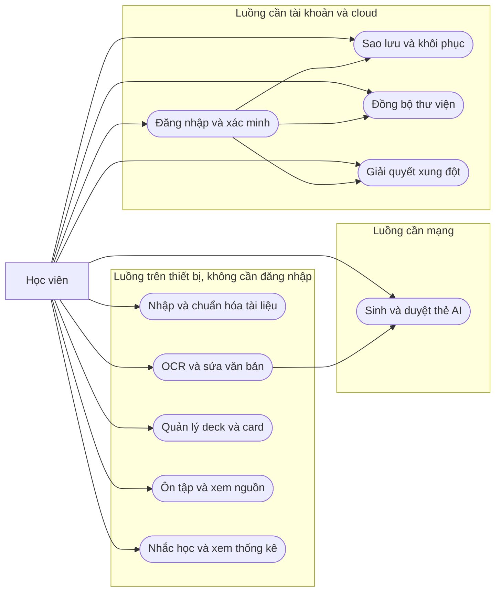
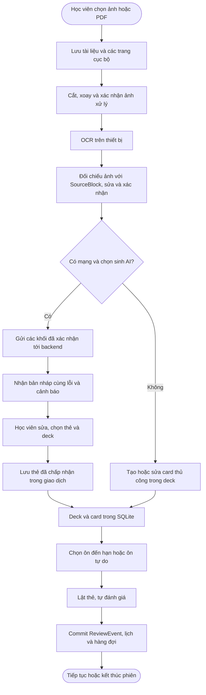
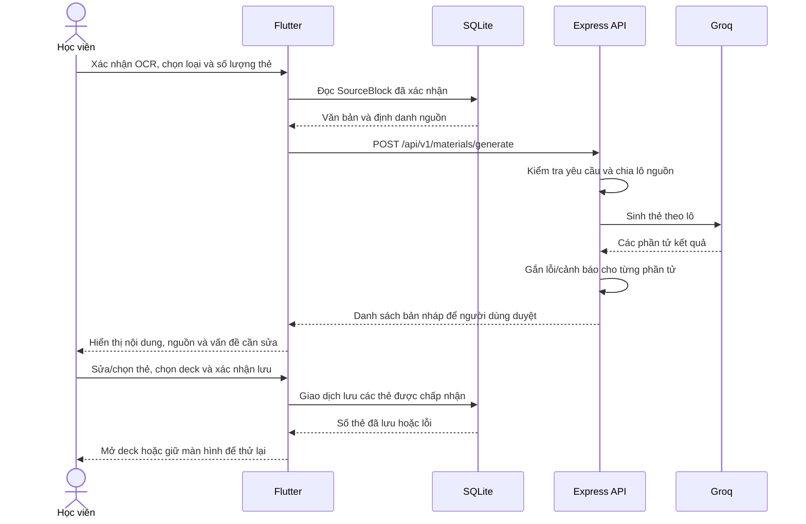
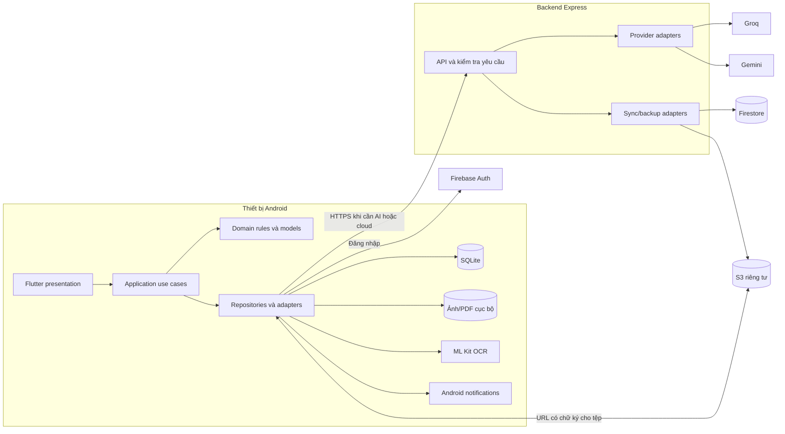
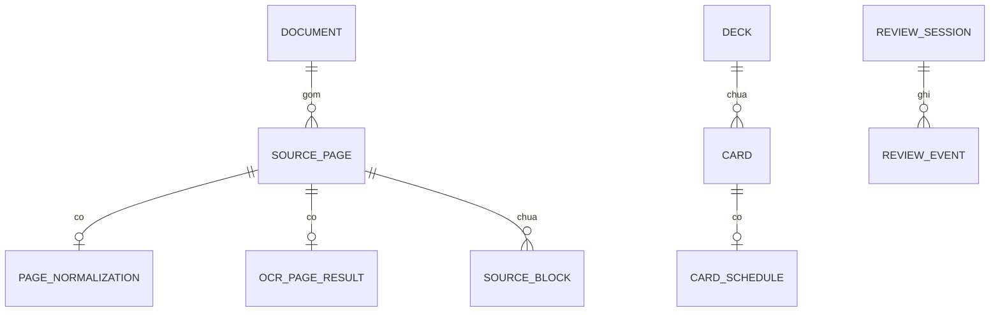
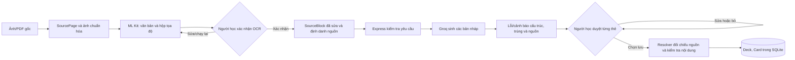
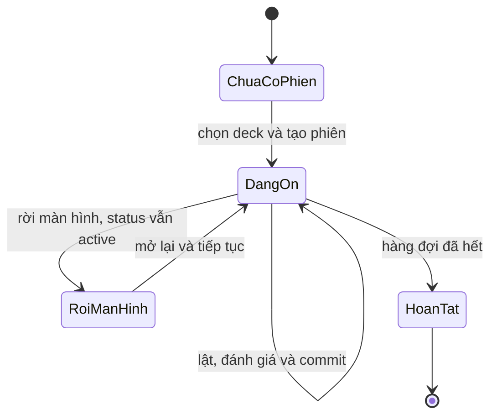
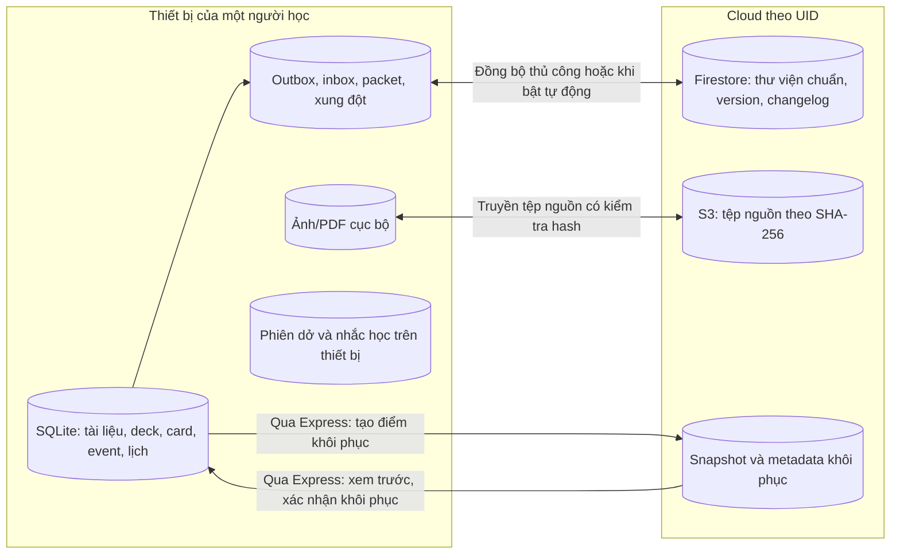

# CHƯƠNG 2. MÔ HÌNH HÓA VÀ THIẾT KẾ HỆ THỐNG

## 2.1. Use case và luồng nghiệp vụ

MemoMind có hai nhóm luồng sử dụng. Nhóm thứ nhất xử lý tài liệu và việc học trên thiết bị: nhập ảnh hoặc PDF, chuẩn hóa trang, nhận dạng và sửa văn bản, quản lý bộ thẻ, ôn tập, nhắc học và xem thống kê. Người học có thể dùng nhóm này với kho khách. Riêng bước sinh học liệu bằng AI cần mạng để gửi văn bản nguồn đã xác nhận tới backend. Nhóm thứ hai quản lý dữ liệu theo tài khoản: xác thực, sao lưu, đồng bộ thư viện và xử lý xung đột. Nhóm này cần tài khoản đã đáp ứng điều kiện xác minh và các dịch vụ cloud được cấu hình. Việc phân nhóm theo điều kiện truy cập giúp giao diện chỉ yêu cầu đăng nhập đúng lúc người dùng chọn một tác vụ cần danh tính.

**Hình 2.1. Use case tổng quan theo điều kiện sử dụng**



Sơ đồ trên diễn tả quyền truy cập và điều kiện vận hành, không có nghĩa mọi tác vụ trong một nhóm phải được thực hiện theo cùng một thứ tự. Chẳng hạn, học viên có thể tạo thẻ thủ công trong một deck mà không cần nhập tài liệu; họ cũng có thể ôn một deck đã lưu khi không còn ảnh nguồn trên máy. Với luồng tạo thẻ từ tài liệu, thứ tự kiểm soát là nhập nguồn, chuẩn hóa ảnh, xác nhận OCR, gọi AI, duyệt thẻ và lưu. Sau khi thẻ được lưu, việc ôn tập không phụ thuộc vào một phiên gọi AI đang hoạt động.

**Bảng 2.1. Đặc tả ngắn các use case cốt lõi**

| Use case và tác nhân | Tiền điều kiện | Luồng chính | Lỗi, hủy hoặc thử lại | Hậu điều kiện và tiêu chí nghiệm thu |
| --- | --- | --- | --- | --- |
| UC01 — Nhập ảnh/PDF và chuẩn hóa; học viên | Ứng dụng có quyền hoặc bộ chọn tệp thích hợp; nguồn đọc được. | Chọn camera, ảnh hoặc PDF; lưu nguồn; chọn trang, cắt/xoay/điều chỉnh và xác nhận ảnh dùng cho OCR. | Hủy chọn giữ kho hiện tại; tệp hỏng, PDF khóa mật khẩu hoặc ảnh xử lý lỗi được báo để chọn lại/thử lại. | Tài liệu, các trang được chọn và ảnh hiển thị đã lưu; mỗi trang gắn đúng tài liệu, số trang và tệp nguồn. |
| UC02 — OCR và hiệu chỉnh; học viên | Có trang ảnh sẵn sàng xử lý. | ML Kit nhận dạng trên thiết bị; hiển thị ảnh cạnh các khối văn bản; học viên sửa và xác nhận. | OCR lỗi cho phép chạy lại; hỗ trợ Gemini chỉ được gọi khi người dùng chọn vùng ảnh và đồng ý gửi. | SourceBlock đã xác nhận gắn đúng trang; OCR lại không âm thầm ghi đè phần người dùng đã sửa hoặc gán tọa độ sai ảnh. |
| UC03 — Sinh, duyệt và lưu học liệu; học viên, backend/AI | Có nội dung nguồn đã xác nhận, mạng và backend khả dụng. | Chọn BASIC/CLOZE/MCQ và số lượng; backend sinh bản nháp; học viên xem, sửa, chọn thẻ và deck đích rồi lưu. | Lỗi mạng/provider giữ cấu hình và nguồn để thử lại; hủy duyệt không lưu; thẻ sai cấu trúc cần sửa, cảnh báo nguồn được hiển thị. | Chỉ thẻ được chấp nhận và có cấu trúc dùng được được lưu trọn giao dịch; không gán một khối nguồn thiếu căn cứ. |
| UC10 — Quản lý deck/card; học viên | Kho cục bộ đã khởi tạo. | Tạo, đổi tên, gắn nhãn, tìm kiếm deck; thêm/sửa/tìm/xóa card. | Hủy xóa giữ dữ liệu; lưu lỗi giữ nội dung biểu mẫu và cho phép thử lại. | Danh sách và số thẻ phản ánh thao tác đã commit; xóa mềm không xóa lịch sử lượt ôn. |
| UC04–UC05 — Ôn tập và lập lịch; học viên, bộ lập lịch | Có thẻ hợp lệ; chế độ đến hạn cần thẻ có ngày ôn không muộn hơn đầu phiên. | Chọn deck/phiên tự do hoặc đến hạn; lật thẻ; chọn Again/Hard/Good/Easy; ghi event, lịch và hàng đợi. | Rời màn hình giữ phiên dở; ghi lỗi không chuyển thẻ; retry dùng lại event ID; thẻ đã xóa/tạm ngừng được bỏ qua khi tiếp tục. | ReviewEvent và trạng thái lịch được commit cùng nhau; phiên có thể khôi phục, hoạt động khi tắt mạng. |
| UC06 — Làm MCQ và xem nguồn; học viên | Có MCQ hoặc thẻ có thông tin nguồn; trang nguồn có thể tồn tại hoặc thiếu. | Chọn đáp án trong giao diện thẻ, xem lời giải; mở trang và câu trích, tô vùng khi tọa độ hợp lệ. | Nguồn thiếu/hỏng vẫn hiển thị câu trích và trang đã lưu khi có; không tô vùng chưa xác minh. | Học viên đối chiếu được thông tin có căn cứ mà không làm thay đổi nội dung hay lịch ôn. |
| UC07 — Nhắc học và thống kê; học viên, Android | Kho có dữ liệu học; nhắc học cần giờ do người dùng lưu và quyền/kênh phù hợp. | Lưu lựa chọn nhắc, lập lịch ngày có thẻ đến hạn; mở thống kê hoặc chạm thông báo để truy vấn danh sách mới. | Quyền/kênh bị chặn được báo; lỗi lập lịch cho phép đối chiếu lại; danh sách đã rỗng hiển thị trạng thái rỗng. | Cài đặt được lưu; bốn chỉ số đọc từ SQLite, không tạo ReviewEvent khi xem thống kê. |
| UC08a — Đăng nhập và xác minh; học viên, Firebase Auth | Có mạng và cấu hình Firebase phù hợp. | Đăng nhập Google/email, hoàn tất xác minh khi cần, chọn cách xử lý kho khách. | Hủy đăng nhập giữ kho khách; lỗi xác thực cho phép thử lại mà không xóa học liệu. | Kho của đúng tài khoản được mở; dữ liệu khách chỉ nhập khi người dùng chọn. |
| UC08b — Sao lưu và khôi phục; học viên, backend/cloud | Tài khoản đủ điều kiện, mạng và dịch vụ sao lưu được cấu hình. | Tạo gói snapshot, tải lên, xác nhận bản hoàn tất; xem trước và chọn khôi phục. | Upload/kiểm tra thất bại giữ bản hiện hành; retry theo cùng định danh hoặc hủy có kiểm soát. | Bản sao được xác nhận theo hash; khôi phục chỉ chuyển kho sau khi kiểm tra và người dùng xác nhận. |
| UC08c — Đồng bộ và giải quyết xung đột; học viên, backend/cloud | Đã chọn thư viện chuẩn theo tài khoản; có thay đổi chờ gửi hoặc thay đổi từ thiết bị khác. | Đồng bộ thủ công hoặc theo tùy chọn tự động; gửi outbox, nhận thay đổi, truyền tệp nguồn; xem và giải quyết xung đột. | Mất mạng/mất phản hồi giữ packet để gửi lại; lỗi xác thực dừng theo loại lỗi; xung đột không tự ghi đè phiên bản khác. | Các thao tác được xác nhận một lần, thay đổi hợp lệ được áp dụng; xung đột và tệp thiếu vẫn có trạng thái theo dõi. |

Các nhãn UC08a–UC08c tách ba thao tác cloud để đặc tả rõ tiền điều kiện và hậu điều kiện của từng thao tác. UC05 là quy tắc hệ thống được gọi sau một đánh giá trong UC04; nó được viết cùng phiên ôn vì sự kiện, lịch và hàng đợi phải cam kết nguyên tử. UC06 tập trung vào trải nghiệm MCQ trong phiên học và khả năng mở nguồn; hệ thống không giả định một chế độ thi bấm giờ riêng.

**Hình 2.2. Luồng hoạt động từ tài liệu đến phiên ôn**



Sơ đồ 2.2 đặt quyết định của người dùng tại hai vị trí quan trọng: xác nhận văn bản trước khi gửi ra ngoài thiết bị và duyệt thẻ trước khi ghi vào lịch ôn. Nhánh tạo thẻ thủ công cho phép tiến tới cùng một kho học cục bộ khi AI chưa khả dụng. Bất kỳ lỗi ghi dữ liệu nào ở bước commit đều giữ người dùng tại trạng thái trước khi thao tác được xác nhận.

**Hình 2.3. Sơ đồ tuần tự của một lần sinh và duyệt học liệu**



Backend trả kết quả ở chế độ người dùng duyệt, bao gồm cả phần tử có vấn đề về cấu trúc hoặc nguồn. Vì vậy, bước kiểm tra ở Flutter phân biệt lỗi nội dung cần sửa trước khi lưu với cảnh báo cần người học xem xét; phản hồi đúng định dạng JSON chưa chứng minh rằng đáp án đúng về mặt học thuật. Việc gọi Gemini để hỗ trợ một vùng OCR là một luồng tùy chọn riêng, không phải bước mặc định trong sơ đồ sinh thẻ này.

**Hình 2.4. Sơ đồ tuần tự của một lượt đồng bộ thư viện**

```mermaid
sequenceDiagram
    actor H as Học viên
    participant F as Flutter và SyncController
    participant DB as SQLite outbox/inbox
    participant Auth as Firebase Auth
    participant API as Express sync API
    participant Cloud as Firestore
    H->>F: Bấm Đồng bộ hoặc đã bật tự động
    F->>Auth: Lấy ID token cho tài khoản hiện tại
    Auth-->>F: ID token
    F->>DB: Đọc packet và thay đổi chưa xác nhận
    DB-->>F: Nhóm thao tác với ID ổn định
    alt Có thay đổi cục bộ đang chờ
        F->>API: Push nhóm thao tác và token
        API->>Cloud: Kiểm tra version, commit và ghi receipt
        Cloud-->>API: Receipt, version hoặc xung đột
        API-->>F: Xác nhận hoặc chi tiết xung đột
        F->>DB: Ghi nhận receipt; giữ xung đột nếu có
    end
    F->>API: GET changes theo cursor
    API->>Cloud: Đọc changelog theo tài khoản
    Cloud-->>API: Trang thay đổi
    API-->>F: Trang thay đổi và cursor
    F->>DB: Áp dụng thay đổi và cursor cùng giao dịch
    F-->>H: Trạng thái đồng bộ và xung đột cần xử lý
```

Nếu không nhận được phản hồi sau khi gửi, ứng dụng giữ nguyên payload và ID để thử lại; nó không tự giả định server chưa commit. Truyền ảnh/PDF là nhánh độc lập với nội dung học: ứng dụng nhận URL có chữ ký từ backend, truyền tệp riêng tới S3 và đối chiếu SHA-256. Tệp nguồn chưa tải xong được báo riêng, trong khi thẻ, lịch và sự kiện đã đồng bộ vẫn có thể được đọc. Khi xung đột nội dung xuất hiện, cả hai phiên bản được giữ cho đến khi người dùng chọn cách giải quyết.

## 2.2. Kiến trúc tổng thể và lựa chọn công nghệ

Ứng dụng Flutter tổ chức mã theo từng tính năng, trong đó giao diện (`presentation`) nhận thao tác và hiển thị trạng thái; lớp điều phối (`application`) thực hiện các use case; mô hình và quy tắc nghiệp vụ (`domain`) mô tả thẻ, phiên ôn, lịch và nguồn; lớp dữ liệu (`data`) hiện thực repository và adapter cho SQLite, tệp, OCR hoặc mạng. Cách tách này cho phép bộ lập lịch SM-2 được kiểm thử như một hàm độc lập, còn các thao tác cần thiết bị hoặc dịch vụ có thể được thay bằng đối tượng giả trong unit/widget test. Không phải mọi tính năng đều cần đủ bốn lớp; các thành phần được tách theo trách nhiệm thực tế của chúng.

Trên thiết bị, SQLite là nơi đọc và ghi chính của học liệu và tiến độ; tệp ảnh/PDF được lưu riêng và tham chiếu từ bản ghi trang. ML Kit nhận dạng văn bản từ ảnh đã chuẩn hóa. Android notification adapter lập lịch nhắc học mà không cần kết nối mạng. Những thao tác cần AI đi qua API Express: backend kiểm tra đầu vào, chia khối văn bản nguồn khi cần và gọi Groq để sinh học liệu; Gemini chỉ xử lý vùng ảnh OCR được gửi theo thao tác chủ động. Khóa nhà cung cấp được giữ ở backend. Các API tài khoản dùng ID token của Firebase Authentication; backend kiểm tra quyền theo tài khoản trước khi truy cập Firestore và S3.

**Hình 2.5. Sơ đồ thành phần và ranh giới triển khai**



**Bảng 2.2. Công nghệ, vai trò và ranh giới sử dụng**

| Công nghệ hoặc thành phần | Vai trò và lý do chọn | Giới hạn cần nêu trong báo cáo |
| --- | --- | --- |
| Flutter và Dart | Xây dựng giao diện Android, điều phối các luồng tài liệu và học tập trong cùng mã ứng dụng. | Các adapter camera, OCR, thông báo và SQLite được nghiệm thu chủ yếu trên Android. |
| Camera, bộ chọn tệp, `pdfrx`, `document_scan` | Tiếp nhận ảnh/PDF, tạo ảnh trang và hỗ trợ cắt/điều chỉnh trước OCR. | Chất lượng ảnh, PDF khóa mật khẩu và khả năng xử lý phụ thuộc dữ liệu đầu vào và thiết bị. |
| ML Kit Text Recognition | OCR trên thiết bị, trả văn bản và khối vị trí để học viên hiệu chỉnh. | Adapter hiện dùng script Latin và không cung cấp confidence dạng số; độ chính xác tiếng Việt cần đo riêng. |
| SQLite qua `sqflite` | Lưu học liệu, phiên, lịch sử, thiết lập và outbox; đọc/ghi được khi mất mạng. | Cần migration và kiểm tra giao dịch khi thay đổi schema. |
| Flutter Local Notifications và API Android | Lập lịch nhắc học theo ngày địa phương từ thẻ đến hạn. | Quyền/kênh và cơ chế tiết kiệm pin của Android có thể ảnh hưởng thời điểm nhận. |
| Express/Node.js | Cung cấp API AI, xác thực/kiểm tra yêu cầu cloud, điều phối sao lưu và đồng bộ. | Tác vụ này cần mạng và cấu hình dịch vụ; khóa server không được đưa vào APK. |
| Groq và Gemini | Groq sinh bản nháp thẻ; Gemini hỗ trợ vùng OCR theo yêu cầu. | Đầu ra AI cần người dùng duyệt; dịch vụ có thể lỗi, trễ hoặc hết hạn mức. |
| Firebase Authentication và Firestore | Xác thực tài khoản; lưu thư viện chuẩn, changelog, xung đột và metadata cloud. | Hoạt động thực tế phụ thuộc cấu hình Firebase và quy tắc bảo mật đã triển khai. |
| Amazon S3 | Lưu tệp nguồn và gói snapshot riêng tư, truyền bằng URL có chữ ký và hash. | Cần xác nhận IAM, bucket policy, checksum và tải thực trên môi trường cloud. |

Trong kiến trúc này, dữ liệu học rời thiết bị trong những luồng cần dịch vụ mà người dùng đã khởi tạo hoặc bật trước đó. Với sinh thẻ, yêu cầu mang nội dung các SourceBlock đã xác nhận và thông tin tối thiểu để đối chiếu nguồn; ảnh nguyên trang không được gửi theo mặc định. Với hỗ trợ OCR, vùng JPEG được chọn mới được gửi qua backend. Với đồng bộ hoặc sao lưu, học liệu và tệp được truyền theo tài khoản đã xác thực. Sau khi đã lưu vào SQLite, ôn tập, thống kê và thông báo cục bộ tiếp tục hoạt động không cần API AI. Các ranh giới này được thể hiện trong `pubspec.yaml`, `functions/package.json`, `lib/app/`, các tính năng dưới `lib/features/` và các route trong `functions/src/app.js`.

## 2.3. Thiết kế dữ liệu cục bộ và truy vết nguồn

Mô hình dữ liệu được xây quanh ba mạch liên kết. Mạch nguồn gồm `documents`, `source_pages`, ảnh sau chuẩn hóa, kết quả OCR và `source_blocks`; mỗi khối có định danh, văn bản gốc, văn bản đã sửa, số trang và tọa độ tương đối. Mạch học liệu gồm `decks` và `cards`; một deck có nhiều card thuộc ba loại BASIC, CLOZE và MCQ. Mạch tiến độ gồm `review_sessions`, `review_events` và `card_schedules`. Một phiên giữ hàng đợi còn lại trên thiết bị, một lần đánh giá tạo ReviewEvent có ID riêng, còn CardSchedule biểu diễn trạng thái lập lịch hiện tại của thẻ. Các thiết lập nhắc học nằm trong `app_settings`; outbox, metadata, inbox, packet và bản ghi xung đột của đồng bộ nằm trong các bảng `sync_*`.

**Hình 2.6. ERD rút gọn theo quan hệ nghiệp vụ**



Sơ đồ 2.6 mô tả quan hệ nghiệp vụ ở mức rút gọn. Liên kết từ Card đến Document/Page/SourceBlock là tham chiếu nguồn có thể để trống hoặc không còn phân giải được, không phải khóa ngoại bắt buộc trong schema v11. Tương tự, `review_events.card_id` là định danh lịch sử, không ràng buộc khóa ngoại tới bảng cards; nhờ đó việc xóa mềm hoặc mất nguồn không xóa các lượt ôn đã ghi. `card_schedules` gắn với card theo `card_id` về mặt nghiệp vụ và được đồng bộ riêng với nội dung thẻ. Những khác biệt giữa quan hệ nghiệp vụ và ràng buộc SQL cần được giữ rõ khi đọc ERD.

**Bảng 2.3. Thực thể cục bộ và khóa/quan hệ quan trọng**

| Thực thể | Khóa và dữ liệu đại diện | Quan hệ hoặc quy tắc toàn vẹn |
| --- | --- | --- |
| Document | `document_id`, tên, trạng thái, metadata và hash PDF gốc nếu có. | Là cha của các trang tài liệu; nguồn mặc định riêng tư. |
| SourcePage và PageNormalization | `page_id`, `document_id`, số trang, tệp ảnh gốc; ảnh hiển thị, phép cắt/xoay và hash. | Trang thuộc một Document; ảnh xử lý phải gắn lại đúng trang nguồn. |
| OcrPageResult và SourceBlock | `page_id` hoặc `block_id`, văn bản nhận dạng/sửa, trạng thái, tọa độ và `box_image_sha256`. | Khối thuộc đúng tài liệu/trang; tọa độ chỉ có nghĩa với ảnh được xác minh. |
| Deck và Card | `deck_id`, `card_id`, loại/nội dung/nhãn/trạng thái; các trường trang, khối và câu trích tùy chọn. | Card thuộc một Deck; tham chiếu nguồn không được dùng để xóa kéo theo card. |
| ReviewSession và ReviewEvent | `session_id`, queue/learning queue/trạng thái; `event_id`, card ID lịch sử, thời điểm, rating, device ID. | Event thuộc phiên; `event_id` duy nhất, lịch sử được giữ khi card/deck bị xóa thông thường. |
| CardSchedule | `card_id`, EF, số lần thành công, interval, ngày đến hạn, thông tin lượt cập nhật cuối. | Tiến độ lập lịch tách khỏi nội dung card để đồng bộ và xử lý đồng thời. |
| AppSettings và các bảng đồng bộ | Khóa thiết lập; `sync_outbox`, `sync_packets`, `sync_inbox`, `sync_meta`, `sync_conflicts`, `sync_state`. | Giữ lựa chọn trên thiết bị, thao tác chưa xác nhận, cursor/version và xung đột. |

Khả năng truy vết nguồn phụ thuộc đồng thời vào nội dung và hình học. Một card AI giữ `source_document_id`, số trang, `source_block_id` khi tìm được, cùng `source_quote` để người học kiểm tra. Khối OCR lưu hộp tọa độ chuẩn hóa theo ảnh đã xử lý và dấu SHA-256 của ảnh dùng khi tạo hộp. Khi mở nguồn, ứng dụng chỉ tô vùng nếu tài liệu, trang, hash ảnh, hộp hữu hạn và giới hạn hộp đều hợp lệ trên ảnh có thể giải mã. Nếu câu trích xuất hiện ở nhiều khối, bị diễn đạt lại hoặc nguồn bị mất, bộ phân giải không đoán vị trí; thẻ vẫn giữ nội dung, câu trích và số trang đã lưu nếu những dữ liệu ấy còn có. Thiết kế này giảm nguy cơ một vùng tô sáng sai tạo cảm giác đáp án đã được nguồn xác nhận.

Schema SQLite hiện được mở ở phiên bản 11. Các migration giữ dữ liệu học khi bổ sung khả năng ôn tập, sao lưu và đồng bộ. Bản sao khôi phục là gói dữ liệu được tạo từ workspace cùng các tệp liên quan; nó không phải một bảng thay thế cho thư viện SQLite đang được học. Bộ giải mã snapshot chấp nhận các schema 9, 10 và 11 trong phạm vi hợp đồng đã kiểm thử.

**Bảng 2.4. Các mốc schema có ý nghĩa đối với thiết kế hiện tại**

| Phiên bản | Thay đổi chính | Dữ liệu cần giữ khi nâng cấp |
| --- | --- | --- |
| v5–v6 | Thêm deck/card và ba dạng nội dung BASIC, CLOZE, MCQ. | Tài liệu, trang, OCR và liên kết nguồn của thẻ. |
| v7–v8 | Thêm phiên ôn, ReviewEvent, thiết lập; hoàn thiện nhãn, trạng thái và xóa mềm deck/card. | Event, queue, lịch, ID thẻ và dữ liệu nguồn lịch sử. |
| v9 | Thêm revision của workspace để chụp snapshot nhất quán. | Toàn bộ dữ liệu học và tệp nguồn của gói sao lưu. |
| v10 | Thêm `card_schedules`, outbox/inbox, version và xung đột đồng bộ. | Lịch hiện có được chuyển sang bảng lịch riêng; không tính lại lịch cũ chỉ từ event. |
| v11 | Thêm `source_blocks.box_image_sha256` và cập nhật trigger bắt thay đổi. | Văn bản OCR, packet/outbox và khả năng khôi phục snapshot v9/v10/v11. |

Các chi tiết schema và đường nâng cấp nằm trong `lib/core/database/memo_mind_database.dart` và `lib/core/database/sync_schema.dart`; quy tắc xác minh hình học nguồn được kiểm chứng trong `docs/source-geometry-validation.md`. Bảng 2.4 chỉ ghi những mốc liên quan trực tiếp tới kiến trúc báo cáo, không thay thế mô tả từng câu lệnh migration.

## 2.4. Thiết kế pipeline tài liệu, OCR và AI

Pipeline bắt đầu bằng việc giữ tệp hoặc ảnh gốc trong vùng dữ liệu ứng dụng. Ảnh lấy từ camera/thư viện và các trang được chọn từ PDF được tạo thành SourcePage. Mỗi trang có thể được cắt, xoay và điều chỉnh trước khi đưa vào OCR; kết quả chuẩn hóa có đường dẫn và hash riêng để phân biệt với ảnh gốc. ML Kit đọc ảnh đang được hiển thị, trả văn bản và các khối vị trí. Học viên đối chiếu hai phía ảnh–văn bản, sửa những chỗ nhận dạng sai và xác nhận phần nội dung dùng cho sinh thẻ. Nếu ảnh đổi trong lúc OCR đang chạy, kết quả cũ không được gắn vào ảnh mới; khi OCR lại, hệ thống chỉ tái sử dụng vị trí có căn cứ và giữ nguyên phần văn bản đã được người dùng sửa.

Điểm kiểm soát đầu tiên của con người là xác nhận OCR. Sau bước này, người dùng chọn loại thẻ và chế độ số lượng. Flutter gửi các SourceBlock đã xác nhận cùng định danh tài liệu tới `POST /api/v1/materials/generate`; backend kiểm tra giới hạn đầu vào, chia văn bản thành các lô nguồn và gọi Groq. Phản hồi ở chế độ duyệt giữ các phần tử do nhà cung cấp trả về để giao diện chỉ ra lỗi và cảnh báo, kể cả khi có thẻ trùng hoặc sai liên kết nguồn. Nếu phản hồi không thể đọc theo cấu trúc mong đợi, backend thử sửa định dạng một lần rồi báo lỗi nếu vẫn thất bại. Điểm kiểm soát thứ hai là màn hình duyệt: học viên sửa câu hỏi/đáp án, xem trích dẫn, chọn thẻ sẽ lưu và quyết định deck đích. Bước lưu kiểm tra cấu trúc thẻ có thể dùng được và ghi các thẻ được chọn trong một giao dịch SQLite.

**Hình 2.7. Dữ liệu, điểm xác nhận và các trường hợp dừng trong pipeline**



Nguồn của thẻ được xem là thông tin có thể kiểm tra, không phải bảo đảm tự động về tính đúng. Bộ phân giải chỉ giữ hoặc sửa liên kết tới SourceBlock khi câu trích khớp duy nhất trong tài liệu và trang phù hợp. Câu trích không khớp, lặp ở nhiều chỗ hoặc chỉ diễn đạt lại sẽ để liên kết chưa xác định; giao diện giữ cảnh báo để học viên cân nhắc. Hộp tô sáng còn phải vượt qua kiểm tra hash và hình học tại thời điểm mở trang. Do đó, kiểm tra JSON, kiểm tra định danh nguồn và xác minh câu trả lời là ba công việc khác nhau: hai công việc đầu có thể tự động hóa một phần, còn chất lượng ngữ nghĩa vẫn cần đánh giá của người học hoặc phép đánh giá độc lập.

**Bảng 2.5. Cấu trúc ba loại thẻ với nội dung minh họa không dùng dữ liệu cá nhân**

| Loại | Mặt trước và dữ liệu riêng | Mặt sau hoặc phản hồi | Thông tin nguồn đi kèm |
| --- | --- | --- | --- |
| BASIC | `front = "Khái niệm X là gì?"` | `back = "Định nghĩa X trong tài liệu."` | Tài liệu, trang, `sourceBlockId` khi xác định được và `sourceQuote`. |
| CLOZE | `front = "Quy trình X gồm [...] bước."` | `back = "Ba"` | Cùng bộ trường nguồn; phần khuyết phải là nội dung người học có thể tự nhớ lại. |
| MCQ | `front = "Điều kiện nào áp dụng cho X?"`; bốn lựa chọn A–D và `correctOptionId`. | Đáp án được chọn, đáp án đúng và `explanation`. | Cùng bộ trường nguồn; nội dung câu hỏi và lời giải được duyệt trước khi lưu. |

Ba dòng trên mô tả cấu trúc, không phải kết quả AI đã được đánh giá. Với thẻ tạo thủ công, các trường nguồn có thể rỗng. Với thẻ sinh từ tài liệu, câu trích được giữ ngay cả khi `sourceBlockId` không được gán một cách chắc chắn. Các điểm hiện thực để đối chiếu gồm `lib/features/document_import/`, `lib/features/image_normalization/`, `lib/features/ocr_editor/`, `lib/features/material_generation/` và `functions/src/`.

## 2.5. Thiết kế học ngoại tuyến và SM-2

Phiên ôn được tạo từ các card đang hoạt động và có nội dung hợp lệ. Chế độ đến hạn chọn card có `due_date` không muộn hơn thời điểm bắt đầu phiên; chế độ tự do không áp điều kiện ngày đến hạn. Người học lật thẻ để xem đáp án trước khi được đánh giá. Mỗi lần chọn Again, Hard, Good hoặc Easy tạo ReviewEvent với ID, card ID, session ID, device ID và thời điểm đánh giá; đồng thời cập nhật lịch và hàng đợi của phiên trong một giao dịch. Một phiên đang dở tiếp tục được đọc từ SQLite sau khi rời màn hình hoặc mở lại ứng dụng; card đã xóa hoặc tạm ngừng được lọc khỏi hàng đợi khi khôi phục. Quy tắc này cho phép việc học diễn ra không cần mạng và tránh giao diện tiến sang card tiếp theo khi ghi dữ liệu thất bại.

Bộ lập lịch là biến thể SM-2 với bốn mức phản hồi. Trạng thái mới của một card có hệ số dễ nhớ ban đầu `EF = 2,5`, số lần thành công `repetitions = 0` và chu kỳ `interval = 0`, nên thẻ có thể đến hạn ngay. Với điểm chất lượng `q`, hệ số được cập nhật theo `EF_mới = max(1,3; EF_cũ + 0,1 − (5 − q) × [0,08 + (5 − q) × 0,02])`. Nếu `q ≥ 3`, số lần thành công tăng một; chu kỳ thành công thứ nhất là một ngày, thứ hai là sáu ngày, từ lần thứ ba là `round(interval_cũ × EF_cũ)` ngày. Công thức chu kỳ dùng **EF trước lần đánh giá hiện tại**. Với Again (`q = 1`), số lần thành công trở về 0, lịch dài hạn đặt một ngày kể từ lúc đánh giá và card được đưa vào cuối learning queue để có thêm một lượt trong cùng phiên. Ngày đến hạn dài hạn được tính từ thời điểm đánh giá UTC cộng số ngày theo khoảng 24 giờ; việc xác định “hôm nay” trên giao diện dùng ngày lịch địa phương.

**Bảng 2.6. Ánh xạ phản hồi và tác động lên một lượt ôn**

| Nút | `q` | Thay đổi lịch dài hạn | Hàng đợi của phiên |
| --- | ---: | --- | --- |
| Again | 1 | `repetitions = 0`, `interval = 1` ngày; EF giảm theo công thức nhưng không dưới 1,3. | Thêm card vào cuối learning queue. |
| Hard | 3 | Tăng `repetitions`; chu kỳ theo mốc 1, 6 hoặc `round(interval_cũ × EF_cũ)`; EF giảm. | Hoàn tất lượt hiện tại. |
| Good | 4 | Tăng `repetitions`; chu kỳ theo cùng quy tắc; EF giữ nguyên. | Hoàn tất lượt hiện tại. |
| Easy | 5 | Tăng `repetitions`; chu kỳ theo cùng quy tắc; EF tăng 0,1. | Hoàn tất lượt hiện tại. |

**Bảng 2.7. Ví dụ tính tay ba lần Easy liên tiếp từ một thẻ mới**

| Lần đánh giá | Thời điểm giả định | `repetitions` sau đánh giá | `interval` sau đánh giá | EF cũ → EF mới | Ngày đến hạn tiếp theo |
| --- | --- | ---: | ---: | --- | --- |
| 1 | `t₀` | 1 | 1 ngày | 2,5 → 2,6 | `t₀ + 1 ngày` |
| 2 | `t₀ + 1 ngày` | 2 | 6 ngày | 2,6 → 2,7 | `t₀ + 7 ngày` |
| 3 | `t₀ + 7 ngày` | 3 | `round(6 × 2,7) = 16` ngày | 2,7 → 2,8 | `t₀ + 23 ngày` |

Ví dụ trong Bảng 2.7 cùng kết quả với ca kiểm thử chu kỳ thứ ba của `test/unit/sm2_scheduler_test.dart`. Nó chỉ minh họa logic lịch, không dự báo hiệu quả ghi nhớ của người học. Khi trạng thái lịch đã lưu bị thiếu hoặc không hợp lệ, bộ lập lịch khởi tạo lại một trạng thái nhất quán trước khi áp dụng đánh giá; thao tác này cũng được kiểm thử riêng.

**Hình 2.8. Trạng thái phiên ôn trên thiết bị**



Hai trạng thái “Đang ôn” và “Rời màn hình” trong Hình 2.8 mô tả trạng thái tương tác của người dùng; khi chỉ tạm rời màn hình, bản ghi phiên vẫn mang trạng thái `active`. Bản ghi ReviewEvent không bị xóa khi deck/card được xóa mềm thông thường. `lib/features/review/domain/sm2_scheduler.dart`, repository phiên ôn và các test trong `test/unit/sm2_scheduler_test.dart` là cơ sở đối chiếu phép tính và giao dịch.

## 2.6. Thiết kế nhắc học, thống kê, tài khoản và đồng bộ

Nhắc học được thiết kế như một chức năng cục bộ trên Android. Người dùng lưu một giờ theo múi giờ địa phương; ứng dụng đối chiếu các card hợp lệ với lịch đến hạn và đặt tối đa một thông báo cho mỗi ngày có thẻ dự kiến đến hạn trong cửa sổ từ hôm nay đến sáu ngày tiếp theo. Cửa sổ được làm mới khi ứng dụng khởi động, trở lại foreground hoặc sau các thay đổi học tập đã commit. Quyền thông báo và kênh Android được kiểm tra riêng với lựa chọn bật của người dùng. Khi chạm thông báo, ứng dụng truy vấn lại card đến hạn ở thời điểm hiện tại thay vì lưu cứng danh sách card trong payload. Cơ chế này không cam kết hệ điều hành sẽ phát đúng từng phút hoặc tiếp tục lập lịch vô hạn khi ứng dụng không được mở lại.

Thống kê cũng đọc dữ liệu từ SQLite mà không tạo hoặc sửa sự kiện học. Trang chủ và màn hình Thống kê dùng cùng một snapshot gồm số card hiện đến hạn, số lượt đánh giá được ghi trong ngày địa phương, tỷ lệ lượt có mức Hard/Good/Easy trên tổng lượt đánh giá hôm nay, và số ngày học liên tiếp hiện tại. Mẫu số của tỷ lệ là **lượt đánh giá**, nên nhiều lần đánh giá cùng một thẻ được tính nhiều lượt; khi chưa có lượt, tỷ lệ hiển thị là dấu gạch thay vì 0%. Các mốc ngày được suy ra theo múi giờ của thiết bị, trong khi timestamp lịch ôn vẫn là thời điểm UTC. Truy vấn thống kê cần dùng cùng thời điểm tham chiếu cho các chỉ số và cập nhật lại khi lượt học thay đổi, qua nửa đêm, đến mốc card đến hạn hoặc khi ứng dụng tiếp tục hoạt động.

Đối với tài khoản, mỗi UID có một thư viện chuẩn trên cloud, còn học liệu của khách có thể được nhập theo lựa chọn hoặc giữ riêng. Thư viện chuẩn đồng bộ nội dung, lịch và ReviewEvent; outbox trên thiết bị giữ thao tác chưa được server xác nhận. Backend xác thực ID token, kiểm tra phiên bản và cha bắt buộc của đối tượng rồi cam kết thao tác, receipt và changelog trong giao dịch Firestore. Nếu nội dung cùng được sửa trên hai thiết bị, bản xung đột được giữ để người dùng chọn; ReviewEvent được nhận diện theo `event_id`, còn trạng thái lịch có cơ chế chọn phiên bản theo thông tin lượt đánh giá. Tệp nguồn được đồng bộ riêng theo SHA-256 và có thể còn ở trạng thái chờ sau khi nội dung học đã về máy. Queue, learning queue, thiết lập nhắc học, đường dẫn tệp cục bộ và thông tin đăng nhập không được coi là dữ liệu cần đưa lên thư viện chuẩn.

Một snapshot sao lưu là điểm khôi phục có phiên bản và tệp đi kèm, được tạo/khôi phục theo quy trình riêng với giao thức đồng bộ các thay đổi hằng ngày. Người dùng có thể xem trước bản sao; việc khôi phục được xác nhận và có bước bảo vệ dữ liệu hiện hành. Đồng bộ thủ công là mặc định: sau khi đăng nhập, người dùng chủ động tải thư viện và gửi thay đổi. Tùy chọn tự động chỉ hoạt động khi được bật cho tài khoản trên thiết bị đó; nó không có nghĩa ứng dụng sẽ chạy đồng bộ nền sau khi bị đóng. Khi mất mạng hoặc không nhận phản hồi, packet và ID thao tác được giữ để thử lại. Lỗi xác thực, cấu hình, dữ liệu và xung đột được phân loại để tránh tự động thử lại vô hạn hoặc ghi đè dữ liệu sai tài khoản.

**Hình 2.9. Ranh giới dữ liệu cục bộ, thư viện chuẩn và điểm khôi phục**



**Bảng 2.8. Tình huống biên và cách bảo toàn dữ liệu**

| Tình huống | Hành vi thiết kế | Dữ liệu được giữ hoặc bước cần xác nhận |
| --- | --- | --- |
| Mất mạng trước hoặc sau khi gửi | Giữ outbox/packet; chỉ xóa khi có receipt hợp lệ; gửi lại cùng ID khi kết quả chưa rõ. | Thay đổi cục bộ và định danh thao tác. |
| Hai thiết bị sửa cùng nội dung | Server ghi nhận xung đột; giao diện cho người dùng xem và giải quyết. | Hai phiên bản nội dung và lịch sử lượt học. |
| Tệp nguồn chưa tải xong hoặc sai hash | Báo trạng thái media riêng và thử tiếp; nội dung/lịch đã đồng bộ vẫn dùng được. | Metadata nguồn, hash và tiến độ truyền tệp. |
| Đổi tài khoản khi đồng bộ đang chạy | Bỏ qua phản hồi của UID cũ đối với workspace hiện hành. | Kho của từng tài khoản và thay đổi chờ của chính kho đó. |
| Khôi phục snapshot | Kiểm tra gói, xem trước, tạo điểm an toàn và yêu cầu xác nhận trước khi áp dụng. | Dữ liệu hiện hành cho tới khi bước chuyển kho hoàn tất. |
| Quyền thông báo bị từ chối hoặc ứng dụng lâu không mở | Giữ lựa chọn giờ và ý định bật; hiển thị trạng thái quyền, đối chiếu lại lịch khi app hoạt động. | Lịch học và ReviewEvent không bị ảnh hưởng bởi lỗi nhắc học. |

Thiết kế của mục này được thể hiện trong `lib/features/reminders/`, `lib/features/statistics/`, `lib/features/account_backup/`, `lib/features/sync/`, `functions/src/sync/` và `functions/src/backup/`. Các sơ đồ mô tả giao thức đã hiện thực trong mã; việc nghiệm thu với hai thiết bị Android và Firebase/S3 thật vẫn cần được báo cáo tách khỏi kiểm thử bằng mock, in-memory store hoặc emulator.
