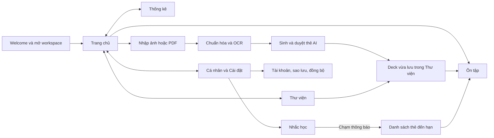

# CHƯƠNG 3. HIỆN THỰC ỨNG DỤNG MEMOMIND

Chương này trình bày cách các thiết kế ở Chương 2 được đưa vào ứng dụng Android và backend. Trọng tâm là màn hình người học thực sự thao tác, dữ liệu được xử lý sau mỗi thao tác, cách hệ thống giữ trạng thái khi gặp lỗi và vị trí có thể kiểm tra trong mã nguồn. Các hình giao diện được đánh dấu **[Cần bổ sung ảnh chụp]** để chèn ảnh từ bản Android cuối cùng; vị trí này không được hiểu là một kết quả kiểm thử thiết bị đã hoàn tất.

## 3.1. Khởi động, giao diện và điều hướng

Điểm vào của ứng dụng là `MemoMindBootstrap`. Trên Android, thành phần này khởi tạo Firebase khi có cấu hình, mở `WorkspaceRepository` theo kho khách hoặc UID hiện hành, rồi tạo controller tài khoản. Lỗi cấu hình cloud không ngăn mở kho học cục bộ. `StartupWelcomeGate` giữ màn hình Welcome trong lúc chờ khởi tạo và hiển thị thông báo cùng thao tác thử lại nếu không mở được workspace. Sau khi kho sẵn sàng, `MemoMindApp` đọc tổng quan ban đầu từ dữ liệu cục bộ và chuyển sang giao diện chính. Cơ chế này tránh để người học nhìn thấy Trang chủ khi cơ sở dữ liệu chưa sẵn sàng hoặc khi một lần đổi tài khoản vẫn đang chuyển kho.

Giao diện chính có thanh điều hướng dưới với bốn tab: Trang chủ, Thư viện, Thống kê và Cá nhân. Trang chủ đặt tác vụ ôn tập ở vị trí nổi bật và dùng nút “Tạo học liệu” để mở lựa chọn camera, thư viện ảnh, PDF hoặc tạo deck thủ công. Ôn tập là một luồng màn hình được mở từ Trang chủ, danh sách thẻ đến hạn hoặc deck; nó không phải tab thứ năm. Thư viện hiển thị các deck và trạng thái đồng bộ, Thống kê đọc snapshot học tập, còn Cá nhân dẫn tới cài đặt nhắc học và quản lý tài khoản. Dữ liệu tổng quan có trạng thái đang tải, rỗng và lỗi; khi đọc thất bại, nút thử lại gọi lại truy vấn thay vì giữ một con số cũ như dữ liệu hiện hành.

`MemoMindApp` cũng đăng ký gateway thông báo và lắng nghe vòng đời ứng dụng. Một lần chạm thông báo được giữ lại cho tới khi cơ sở dữ liệu và Navigator sẵn sàng, sau đó mở danh sách thẻ đến hạn bằng truy vấn mới. Khi lưu các thẻ AI đã chọn, `MaterialGenerationFlow.openSavedDeck` đưa người dùng về tuyến Trang chủ → Thư viện → deck vừa lưu; màn hình nhập và OCR trước đó không còn nằm trên ngăn điều hướng đang hoạt động. Những lối tắt Trang chủ có dữ liệu minh họa như “Chi tiết tài liệu”, “Duyệt thẻ AI” hoặc “Tác vụ học liệu” hiện có thể mở màn hình chờ; luồng duyệt thẻ đã hiện thực được truy cập từ quy trình OCR → sinh học liệu. Vì vậy, sơ đồ điều hướng dưới đây chỉ dùng mũi tên đặc cho tuyến đang có chức năng đích.

**Hình 3.1. Điều hướng chính được hiện thực trên Android**

Mã để đối chiếu gồm `lib/app/memo_mind_bootstrap.dart`, `lib/app/startup_welcome_gate.dart`, `lib/app/app.dart` và `lib/features/home/presentation/home_screen.dart`. Các widget test `test/widget/startup_welcome_test.dart` và `test/widget/home_screen_test.dart` kiểm tra cổng khởi động, trạng thái tải/lỗi và thao tác trên Trang chủ. **Hình 3.2 [Cần bổ sung ảnh chụp]:** Welcome, Trang chủ và bốn tab trên cùng bản APK Android cuối; ghi thiết bị, phiên bản Android, kích thước màn hình và thời điểm chụp. Nếu dùng `build/android-home.png` làm tư liệu, cần kiểm tra lại nó có đúng phiên bản giao diện được nộp hay không.

## 3.2. Nhập và chuẩn hóa tài liệu

Luồng nhập ảnh mở camera hoặc bộ chọn ảnh theo lựa chọn ở Trang chủ. `DocumentImportFlow` cho xem ảnh ứng viên trước khi xác nhận, kiểm tra khả năng đọc và chất lượng cơ bản, rồi sao chép nguồn vào vùng lưu trữ của ứng dụng cùng bản ghi tài liệu và trang. Khi camera bị hủy, quyền bị từ chối, ảnh hỏng hoặc thao tác lưu lỗi, giao diện cho chọn lại nguồn hay thử lại; ứng viên chưa xác nhận không được biến thành một trang học liệu hoàn chỉnh. Danh sách trang nhập xong cho biết trang nào đang chờ xử lý và dẫn tới bước chuẩn hóa.

Với PDF, `PdfImportFlow` kiểm tra tệp, hiển thị ảnh thu nhỏ và cho chọn trang hoặc phạm vi trang. Một lượt xử lý nhận tối đa mười trang đã chọn; giới hạn này giúp kiểm soát số ảnh cần giải mã và OCR trong một thao tác. Các trang được render thành ảnh để đi tiếp trong cùng pipeline với ảnh camera/thư viện, còn tệp PDF gốc vẫn được giữ để có thể kiểm tra nguồn. PDF không đọc được hoặc được bảo vệ bằng mật khẩu được báo tại bước nhập; người dùng có thể chọn tệp khác hoặc chọn lại trang thay vì ghi một tài liệu thiếu trang mà không biết nguyên nhân.

`PendingProcessingScreen` trình bày các trang đang chờ. Với từng trang, `ImageNormalizationEditorScreen` tách bước chọn vùng cắt khỏi bước điều chỉnh; người dùng có thể xoay 90 độ, cắt theo vùng, thay đổi tương phản và xem trước trước khi áp dụng. Ảnh đã xử lý có đường dẫn, kích thước và SHA-256 riêng; bản gốc không bị ghi đè. Điều đó quan trọng đối với OCR: tọa độ khối văn bản chỉ có nghĩa trên ảnh đã đưa vào bộ nhận dạng. Nếu người dùng chỉnh lại một trang, các vị trí OCR cũ phải được kiểm tra lại trước khi hiển thị hoặc dùng làm nguồn thẻ.

Các lớp liên quan nằm trong `lib/features/document_import/` và `lib/features/image_normalization/`. `test/widget/document_import_flow_test.dart`, `test/widget/pdf_import_flow_test.dart` và `test/widget/image_normalization_flow_test.dart` kiểm tra các lựa chọn và trạng thái giao diện bằng dữ liệu kiểm thử. **Hình 3.3 [Cần bổ sung ảnh chụp]:** cùng một trang trước và sau chuẩn hóa, kèm màn hình chọn trang PDF hoặc danh sách trang chờ. Cần ghi loại nguồn, thiết bị, ánh sáng và thao tác đã áp dụng nếu dùng cặp ảnh này để bàn về khả năng đọc; không suy ra mức cải thiện OCR chỉ bằng quan sát ảnh.

## 3.3. OCR và xác nhận nội dung

Người học chọn những trang cần nhận dạng và theo dõi tiến trình từng trang tại `OcrPageSelectionScreen` và `OcrProcessingScreen`. `OcrOrchestrator` đưa ảnh hiển thị của trang tới ML Kit Text Recognition trên thiết bị, chuyển các đoạn trả về thành `SourceBlock`, chuẩn hóa hộp tọa độ theo kích thước ảnh và lưu kết quả của từng trang. Khối rỗng được bỏ qua; trang lỗi được ghi nhận riêng để những trang thành công không bị mất. Adapter OCR đang dùng script Latin và không cung cấp độ tin cậy dạng số cho mọi khối, nên trạng thái cần kiểm tra không thể được diễn giải thành một phép đo xác suất chính xác của văn bản.

Trong `OcrDualViewEditorScreen`, ảnh và danh sách đoạn văn bản được đặt cạnh nhau. Chạm một khối trên ảnh giúp tìm đoạn tương ứng; học viên sửa văn bản, xác nhận hoặc loại đoạn không cần thiết. Trước khi cho sinh thẻ, ứng dụng kiểm tra những đoạn đã xác nhận; nếu còn đoạn cần xem lại, giao diện cảnh báo để người học quyết định. Văn bản gốc do máy nhận dạng, văn bản đã chỉnh và trạng thái duyệt được lưu riêng để một lần chạy OCR tiếp theo không âm thầm xóa sửa chữa trước đó. Màn hình cũng có bộ lọc đoạn cần xem lại và đoạn đã chỉnh nhằm giảm công tìm kiếm trên trang dài.

Gemini là lựa chọn hỗ trợ cho một đoạn khó đọc. Người dùng mở hộp đồng ý, ứng dụng cắt vùng ảnh của đoạn đó và gửi vùng đã chọn qua backend; văn bản đề xuất được đặt cạnh nội dung hiện tại để người học chấp nhận hoặc từ chối. Ảnh nguyên trang không phải dữ liệu mặc định của yêu cầu này. Khi mở lại trang, đổi ảnh hoặc OCR lại, mã đối chiếu `document_id`, `page_id`, kích thước, hộp tọa độ và hash của ảnh dùng để tạo hộp. Vùng tô sáng chỉ xuất hiện khi hình học còn hợp lệ; nếu không, giao diện vẫn có thể giữ câu trích hoặc văn bản nhưng không vẽ một vị trí thiếu căn cứ.

Phần xử lý nằm trong `lib/features/ocr_editor/`; quy tắc kiểm tra vị trí được ghi tại `docs/source-geometry-validation.md`. `test/unit/ocr_orchestrator_test.dart`, `test/widget/ocr_dual_view_editor_test.dart` và các test hồi quy nguồn kiểm tra luồng khối/tọa độ, chỉnh sửa và hành vi khi ảnh không khớp. **Hình 3.4 [Cần bổ sung ảnh chụp]:** ảnh trang, khối OCR đang chọn, văn bản trước/sau chỉnh và hộp đồng ý Gemini trên dữ liệu mẫu hoặc dữ liệu đã che tên, mã sinh viên và ghi chú riêng. Ảnh này mô tả thao tác; độ chính xác OCR tiếng Việt hoặc chữ viết tay chỉ được kết luận sau khi có tập chuẩn và phép đo riêng.

## 3.4. Sinh, duyệt và lưu học liệu AI

Sau khi OCR được xác nhận, `MaterialGenerationConfigModal` cho chọn một hoặc nhiều dạng BASIC, CLOZE, MCQ, các đoạn nguồn dùng để sinh, số lượng tự động hoặc số lượng chỉ định và deck đích. `GenerateMaterialsUseCase` chỉ lấy `SourceBlock` cùng tài liệu/trang, chưa bị xóa, đã được xác nhận hoặc do người dùng thêm, và có văn bản không rỗng. Với số lượng chỉ định, giá trị phải từ số dạng đã chọn đến 30; văn bản nguồn vượt 100.000 ký tự bị chặn trước khi gửi. Các điều kiện này tránh để một thao tác mạng tốn thời gian được khởi chạy với đầu vào không thể sử dụng.

`RemoteMaterialGenerationRepository` gửi yêu cầu tới `POST /api/v1/materials/generate` của Express. Backend kiểm tra kích thước và cấu trúc yêu cầu, giới hạn tần suất, chia nguồn khi cần và gọi Groq bằng khóa giữ ở server. Phản hồi chế độ `user_review` được chuyển thành danh sách bản nháp kèm lỗi hoặc cảnh báo; một JSON đọc được mới chứng minh định dạng có thể phân tích, chưa chứng minh câu trả lời đúng. Nếu nhà cung cấp trả cấu trúc không đọc được, server có thể thử sửa định dạng một lần. Khi gọi lỗi hoặc kết quả rỗng, màn hình thông báo và cho thử lại mà không ghi card.

`FlashcardReviewApprovalScreen` trình bày từng thẻ đề xuất cùng loại, câu hỏi, đáp án và dấu nguồn. Người học có thể chỉnh sửa, chọn từng thẻ, chọn tất cả thẻ đủ điều kiện, bỏ thẻ kèm thao tác hoàn tác, tạo lại thẻ hoặc đổi deck. Lỗi cấu trúc như thiếu trường bắt buộc chặn việc chọn lưu cho tới khi được sửa; cảnh báo trùng hoặc nguồn chưa xác định vẫn hiển thị để người học cân nhắc. Khi rời màn hình với kết quả chưa lưu, giao diện hỏi lại; OCR đã xác nhận vẫn nằm trong kho. `SaveAcceptedCardsUseCase` kiểm tra các bản nháp đã chọn, đối chiếu nguồn và gọi repository lưu cả nhóm trong một giao dịch SQLite. Nếu câu trích không khớp chắc chắn với một SourceBlock, thẻ giữ câu trích nhưng không được gán một khối tùy đoán. Sau khi lưu thành công, ứng dụng mở deck đích với số thẻ vừa thêm.

**Bảng 3.1. Cách màn hình duyệt xử lý các phản hồi AI điển hình**

| Tình huống | Trạng thái hiển thị và thao tác | Kết quả lưu |
| --- | --- | --- |
| BASIC/CLOZE/MCQ có đủ trường và nguồn đối chiếu được | Hiển thị nội dung, loại và trích dẫn; người học vẫn đọc và quyết định chọn. | Lưu khi được chọn và xác nhận. |
| Thiếu đáp án, lựa chọn hoặc cấu trúc bắt buộc | Báo lỗi ngay trên thẻ; cho chỉnh hoặc loại. | Chặn lưu bản nháp còn lỗi. |
| Câu hỏi trùng trong lần sinh hoặc số thẻ trả về nhiều hơn yêu cầu | Hiển thị cảnh báo và giữ kết quả để người học lọc. | Chỉ lưu những thẻ được người học chọn. |
| Câu trích không xác định được một khối duy nhất | Báo cảnh báo nguồn; cho mở trang/câu trích để đối chiếu. | Có thể giữ câu trích, để liên kết khối rỗng. |
| Mạng hoặc nhà cung cấp thất bại | Giữ cấu hình và hiện thao tác thử lại; không đưa kết quả giả vào danh sách. | Không ghi thẻ. |

Mã đối chiếu gồm `lib/features/material_generation/`, `functions/src/app.js` và `functions/src/providers.js`. `functions/test/materials.test.js` cùng `docs/material-review-validation.md` ghi phạm vi kiểm thử backend và màn duyệt; thử prompt với nguồn nhân tạo là quan sát kỹ thuật, không phải đánh giá định lượng chất lượng thẻ trên tài liệu của người dùng. **Hình 3.5 [Cần bổ sung ảnh chụp]:** màn cấu hình và màn duyệt chứa một thẻ BASIC, CLOZE, MCQ trên nguồn mẫu đã ẩn thông tin cá nhân; tuyệt đối không đưa token, URL ký hay khóa API vào hình hoặc chú thích.

## 3.5. Quản lý bộ thẻ, xem nguồn và ôn tập

Tab Thư viện dùng `LibraryDecksScreen` để tìm deck theo tên/nhãn và mở `DeckDetailScreen` xem danh sách thẻ. Người học có thể tạo, đổi tên, gắn nhãn và xóa deck; trong deck có thể tạo thủ công hoặc sửa thẻ BASIC, CLOZE, MCQ. Trường loại thẻ quyết định biểu mẫu nội dung và cách hiển thị đáp án. Repository kiểm tra dữ liệu trước khi ghi, giữ đầu vào trên màn hình khi lưu lỗi, và xóa mềm deck/card thông thường để chúng không trở lại kết quả tìm kiếm hoặc hàng đợi ôn. Hệ thống giữ ReviewEvent cũ nhằm bảo toàn lịch sử tiến độ, kể cả khi học liệu tương ứng đã được xóa khỏi thư viện đang hoạt động.

Với thẻ sinh từ tài liệu, chi tiết thẻ và phiên ôn dùng cùng luồng xem nguồn. Ứng dụng tìm đúng tài liệu, trang và khối trước khi mở ảnh; câu trích đã lưu được trình bày để người học đối chiếu câu hỏi/đáp án. Hộp tô sáng chỉ được vẽ khi tọa độ hợp lệ trên đúng ảnh và dấu SHA-256 tương ứng. Nếu ảnh nguồn bị thiếu, không giải mã được hoặc khối không còn xác định chắc chắn, giao diện không tự tô một vùng gần đúng; phần câu trích và số trang còn có vẫn được hiển thị. Thẻ tạo thủ công không bị buộc phải có liên kết nguồn.

`ReviewSessionScreen` mở phiên đến hạn hoặc ôn tự do theo deck. Người học phải lật thẻ trước khi bốn nút Again, Hard, Good, Easy có hiệu lực. `ReviewSessionController` giữ `event_id` của lần đánh giá đang ghi; nếu thao tác SQLite thất bại, card không chuyển đi và lần thử lại dùng chính ID đó. Repository ghi ReviewEvent, lịch SM-2 và thay đổi hàng đợi trong một giao dịch. Again đưa card về cuối learning queue của phiên; rời màn hình giữ phiên active để lần mở sau tiếp tục. Khi hoàn tất, màn tổng kết đọc kết quả của phiên đã ghi. Những card đã xóa hoặc tạm ngừng không được đưa lại vào phiên khi khôi phục.

Các màn hình và repository nằm trong `lib/features/deck_management/` và `lib/features/review/`. `docs/uc10-uc04-validation.md` ghi một lần chạy `integration_test/offline_deck_review_test.dart` trên Samsung Android khi tắt Wi-Fi và dữ liệu di động: tạo deck/ba loại card, đánh giá Again, đóng/mở database, tiếp tục phiên và kiểm tra lịch sử sau xóa mềm. Bằng chứng đó xác nhận một luồng ngoại tuyến đã thử trên thiết bị, nhưng không thay thế kiểm tra mọi kiểu máy hoặc mọi tình huống hệ điều hành cưỡng bức dừng. **Hình 3.6 [Cần bổ sung ảnh chụp]:** deck có đủ ba dạng thẻ, màn xem nguồn với câu trích/hộp tô hợp lệ, mặt trước/sau của phiên ôn và bốn nút đánh giá; dùng cùng một bộ dữ liệu mẫu để ảnh có thể đối chiếu với nhau.

## 3.6. Nhắc học và thống kê

Trong Cá nhân → Cài đặt → Nhắc học, người dùng bật chức năng và chọn một giờ địa phương. `ReminderSettingsScreen` chỉ áp dụng lựa chọn khi bấm Lưu; đóng hoặc hủy giữ cài đặt trước đó. Ý định bật và giờ chọn được ghi vào SQLite ngay cả khi Android chưa cấp quyền thông báo, nhưng trạng thái giao diện phân biệt điều này với khả năng hệ điều hành thực sự phát nhắc. `ReminderCoordinator` đối chiếu các thẻ đang hoạt động và lịch hợp lệ, rồi lập nhiều nhất một thông báo cho mỗi ngày có thẻ dự kiến đến hạn trong cửa sổ hôm nay và sáu ngày kế tiếp. Những mốc đã qua bị bỏ; khi dữ liệu ôn thay đổi hoặc ứng dụng hoạt động trở lại, cửa sổ được tính lại. Thông báo dùng lịch không chính xác tới từng phút (`inexactAllowWhileIdle`), nên thời điểm xuất hiện thực tế vẫn do Android điều phối.

Payload thông báo chỉ chứa hành động mở danh sách đến hạn, không đóng băng số lượng hay ID card. Khi chạm, `ReminderTapRouter` đợi ứng dụng sẵn sàng rồi truy vấn lại SQLite; nếu người học đã ôn hoặc xóa card từ lúc lập thông báo, danh sách có thể rỗng. Lỗi lập lịch thông báo được xử lý bên ngoài giao dịch lưu ReviewEvent để một quyền bị từ chối không làm mất lượt học. Trường hợp tắt nhắc hủy những thông báo thuộc riêng chức năng này và giữ các thông báo khác của ứng dụng.

Tab Thống kê và khối tổng quan Trang chủ dùng cùng `StatisticsController`. `LocalStatisticsRepository` đọc một snapshot cục bộ gồm số card đến hạn, số lượt đánh giá hôm nay, tỷ lệ lượt được tự đánh giá từ Hard trở lên và chuỗi ngày học. Số lượt là số ReviewEvent đã ghi, nên một card được đánh giá hai lần được tính hai lượt; tỷ lệ này không phải tỷ lệ trả lời đúng của một bài kiểm tra. Khi chưa có lượt trong ngày, giao diện hiển thị dấu gạch thay vì 0%. Mốc “hôm nay” được tính theo lịch và múi giờ của thiết bị, trong khi thời điểm đánh giá vẫn lưu theo UTC. Controller làm mới khi có lượt ôn mới, khi quay lại màn hình hoặc khi vượt mốc ngày/đến hạn; việc đọc thống kê không sửa lịch hay sự kiện học.

Mã nguồn nằm trong `lib/features/reminders/` và `lib/features/statistics/`. `docs/fr16-validation.md` cùng `docs/fr17-validation.md` phân biệt ca unit/widget đã kiểm tra với kịch bản native còn chờ. Hai file `integration_test/reminder_native_test.dart` và `integration_test/offline_statistics_test.dart` có trong dự án, nhưng biên bản hiện có chưa xác nhận chúng đã chạy thành công trên thiết bị Android thực; không được ghi chúng như kết quả nghiệm thu đã đạt. **Hình 3.7 [Cần bổ sung ảnh chụp]:** cài đặt nhắc học khi có và khi thiếu quyền, danh sách đến hạn được mở từ thông báo, Trang chủ/Thống kê của kho trống và kho có lịch sử. Chỉ gắn nhãn “thiết bị thật” cho ảnh cùng nhật ký kiểm tra tương ứng.

## 3.7. Tài khoản, sao lưu và đồng bộ

`AccountBackupScreen` cung cấp đăng nhập Google hoặc email/mật khẩu, tạo tài khoản, gửi xác minh email và đặt lại mật khẩu. Người học có thể đóng màn hình này để tiếp tục dùng kho khách. `WorkspaceRepository` giữ kho riêng cho khách và từng UID; sau khi xác minh, giao diện hỏi người học có muốn nhập dữ liệu khách vào thư viện tài khoản hay giữ riêng. Việc đăng xuất hoặc chuyển UID đổi workspace hiện hành và hủy những thao tác đang gắn với kho cũ, tránh để phản hồi mạng đến muộn được áp dụng vào tài khoản mới. Xác thực được dùng cho tác vụ cloud; học liệu đã lưu trên thiết bị vẫn đọc và ôn ngoại tuyến theo quyền truy cập của workspace đó.

Sao lưu dùng `SnapshotCodec` để chụp trạng thái workspace và tệp nguồn thành một gói có phiên bản. `AccountBackupController` điều phối tạo, tải lên, liệt kê, xem trước, khôi phục và xóa bản sao; backend trong `functions/src/backup/` xác thực UID và quản lý metadata cùng tệp S3. Một bản sao là điểm khôi phục, không tự thay thế thư viện chuẩn đang được học. Trước thao tác khôi phục có ảnh hưởng đến kho hiện hành, giao diện yêu cầu xem trước và xác nhận, đồng thời tạo điểm an toàn theo quy trình đã lập trình. Bộ giải mã hỗ trợ snapshot schema v9, v10 và v11 trong phạm vi hợp đồng kiểm thử; gói hỏng hoặc sai checksum bị từ chối.

Đồng bộ là luồng riêng do `SyncController` và `LocalSyncStore` thực hiện. Theo mặc định, người dùng bấm “Đồng bộ để tải thư viện” hoặc “Đồng bộ ngay”; đăng nhập không tự gửi mọi thay đổi lên cloud. Khi bật tùy chọn tự động trên thiết bị, ứng dụng gom thay đổi và chạy khi còn hoạt động, khi mở lại hoặc có tín hiệu mạng; không có cam kết đồng bộ nền sau khi hệ điều hành đã đóng ứng dụng. Outbox lưu thao tác cục bộ và ID bất biến cho lần gửi lại; server trong `functions/src/sync/` kiểm tra ID token, phiên bản và các quan hệ cha trước khi ghi thư viện chuẩn theo UID. Trường hợp hai thiết bị sửa cùng nội dung được giữ thành xung đột để người học chọn phiên bản. ReviewEvent có ID riêng để nhận diện lần ôn, còn lịch được đồng bộ theo trạng thái đã tính; packet, receipt và cursor giúp lần thử lại không giả định sai rằng một yêu cầu mất phản hồi chưa từng được server ghi.

Ảnh/PDF nguồn được truyền riêng qua URL có chữ ký tới S3 và kiểm tra SHA-256. Vì vậy, thẻ, lịch ôn và lịch sử có thể xuất hiện trên thiết bị khác trước khi tệp nguồn tải xong; giao diện cần báo trạng thái media còn chờ thay vì coi toàn bộ đồng bộ đã hoàn tất. Hàng đợi phiên đang dở, thiết lập nhắc học, đường dẫn tệp tuyệt đối và phiên đăng nhập là dữ liệu của từng thiết bị, không được đưa lên thư viện chuẩn. Lỗi cấu hình cloud, phiên hết hạn, mạng tạm thời và xung đột được hiển thị thành trạng thái khác nhau để người học biết khi nào có thể thử lại và khi nào cần xác thực hoặc chọn dữ liệu.

**Bảng 3.2. Hành vi vận hành của các thao tác tài khoản và dữ liệu**

| Thao tác | Khởi phát và điều kiện mạng | Dữ liệu trao đổi | Khi lỗi hoặc chưa hoàn tất |
| --- | --- | --- | --- |
| Đăng nhập/xác minh | Người dùng chủ động; cần Firebase hoạt động. | Thông tin xác thực với Firebase; ứng dụng nhận trạng thái tài khoản/token. | Giữ kho đang học; báo lỗi hoặc yêu cầu xác minh, không tự thay kho khách. |
| Sao lưu snapshot | Người dùng yêu cầu hoặc điểm khôi phục theo chính sách; cần backend và S3. | Gói workspace có phiên bản, metadata và tệp đi kèm. | Giữ job/định danh để đối chiếu và thử lại; bản ready trước không bị coi là đã mất. |
| Khôi phục snapshot | Chọn bản, xem trước, xác nhận; cần tải cloud. | Gói snapshot đã kiểm tra UID, schema và checksum. | Không chuyển sang kho mới nếu gói chưa hợp lệ hoặc chưa xác nhận. |
| Đồng bộ thủ công mặc định | Người dùng bấm nút; cần backend/Firebase. | Outbox, thay đổi thư viện chuẩn và cursor; tệp nguồn đi riêng. | Giữ thay đổi chưa xác nhận; nút thử lại; tải thay đổi từ cloud ngay cả khi outbox rỗng. |
| Đồng bộ tự động tùy chọn | Bật riêng trên thiết bị; chạy khi ứng dụng hoạt động và có điều kiện kết nối. | Cùng giao thức thư viện chuẩn và media như thao tác thủ công. | Lỗi tạm thời được hẹn thử lại; lỗi phiên/cấu hình dừng và cần người dùng xử lý. |
| Giải quyết xung đột | Người dùng chọn khi có hai bản sửa cùng đối tượng; cần mạng để công bố lựa chọn. | Bản đã chọn và ID xung đột. | Giữ cả hai bản và quyết định chờ gửi trong kho cục bộ cho tới khi được xác nhận. |

Các đường dẫn kiểm chứng là `lib/features/account_backup/`, `lib/features/sync/`, `functions/src/backup/` và `functions/src/sync/`; `docs/deployment/sync-setup.md` mô tả cấu hình, còn `docs/sync-validation.md` nêu ma trận thử trên hai máy. Firebase/S3 thật đã được kết nối. Unit/widget/backend test và một số phép thử với Firestore Emulator đã kiểm tra logic cục bộ, giao thức và quy tắc truy cập trong môi trường giả lập; biên bản hiện có chưa xác nhận hội tụ dữ liệu trên hai thiết bị Android qua dịch vụ thật. **Hình 3.8 [Cần bổ sung ảnh chụp]:** màn tài khoản chưa/đã xác minh, danh sách snapshot, trạng thái “chưa đồng bộ”, media còn chờ và màn xung đột; mỗi ảnh cloud phải ghi cấu hình môi trường thử và tình trạng nghiệm thu, không dùng ảnh giao diện mock để đại diện cho dịch vụ thật.

Nhìn từ đường đi của một tài liệu, các màn hình nhập, chuẩn hóa, OCR, duyệt thẻ và ôn tập đã được nối thành một luồng có lưu bền cục bộ. Những chức năng cần mạng được đặt sau thao tác hoặc lựa chọn rõ ràng của người học, còn trạng thái lỗi được giữ để thử lại mà không làm mất dữ liệu đã ghi. Chương 4 sẽ đối chiếu từng tuyên bố hiện thực ở trên với kết quả kiểm thử, ảnh thiết bị và những phép đo còn cần bổ sung.
